**English** | [简体中文](README.zh-CN.md)

<picture>
  <source media="(max-width: 640px) and (prefers-color-scheme: dark)" srcset="assets/presentation/hero-mobile-dark.svg">
  <source media="(max-width: 640px)" srcset="assets/presentation/hero-mobile-light.svg">
  <source media="(prefers-color-scheme: dark)" srcset="assets/presentation/hero-dark.svg">
  
</picture>

**Run two groups of behavioral probes against a local model endpoint and inspect chat-template and sampling failure signals separately.**

`v0.3.0` · `Python 3.12+` · [MIT](LICENSE)

[Website](https://gapprobe.lei6393.com) · [Demo record](docs/demo-results.json)

## Why use it

When a local model responds unexpectedly, changing templates, sampling and quantization together obscures what helped. GapProbe separates fixed behavioral checks into two groups, retains response snippets for failed probes, and uses built-in rules to suggest where to investigate.

## Architecture

<picture>
  <source media="(max-width: 640px) and (prefers-color-scheme: dark)" srcset="assets/presentation/architecture-mobile-dark.svg">
  <source media="(max-width: 640px)" srcset="assets/presentation/architecture-mobile-light.svg">
  <source media="(prefers-color-scheme: dark)" srcset="assets/presentation/architecture-dark.svg">
  
</picture>

ProbeEngine identifies a registry entry through /v1/models, then sends fixed requests to /v1/chat/completions. Two layers calculate failure ratios from substring checks; registry coefficients convert them to estimates, and verdict assembles the result. The offline bench uses simulated ProbeResult objects without a model connection.

Probe definitions and reference settings are in [registry.py](gapprobe/registry.py); simulated inputs are in [cases.py](gapprobe/cases.py). The current registry covers Qwen3 and DeepSeek.

## Install

Requires Python 3.12+. The bench and registry inspection below are offline; live probes need an already running compatible endpoint.

```bash
git clone https://github.com/SuperMarioYL/GapProbe.git
cd GapProbe
python3 -m venv .venv
source .venv/bin/activate
python -m pip install -e .
```

## Quickstart

The real run executes 20 simulated attribution cases and inspects the registry, matching 20/20 constructed expectations. It checks rule implementation, not model performance, real-world diagnosis accuracy or measured capability loss.

```bash
python -m gapprobe.cli bench
python examples/presentation_registry.py
```

The bench inputs are shipped in cases.py; the registry inspection script is [examples/presentation_registry.py](examples/presentation_registry.py).

## Usage

python -m gapprobe.cli probe --endpoint http://localhost:8080 runs both probe groups. Use --layer chat-template or --layer sampling for one group. It neither starts the server nor changes its settings. Sampling probes run under the server's configured default sampler; when the server exposes its defaults (llama.cpp `/props`), they are diffed against the canonical registry and mismatched parameters are named in the evidence.

## Recorded demo

<picture>
  <source media="(max-width: 640px) and (prefers-color-scheme: dark)" srcset="assets/presentation/process-mobile-dark.svg">
  <source media="(max-width: 640px)" srcset="assets/presentation/process-mobile-light.svg">
  <source media="(prefers-color-scheme: dark)" srcset="assets/presentation/process-dark.svg">
  
</picture>

### Run simulated cases

All twenty constructed cases match their expected labels.

```text
$ python -m gapprobe.cli bench
           GapProbe 20-Case Attribution Bench
┏━━━━━━━━━━━━━━━━━┳━━━━━━━━━━━━━━━┳━━━━━━━━━━━━━━━┳━━━━━┓
┃ Case            ┃ Predicted     ┃ Expected      ┃ ✓/✗ ┃
┡━━━━━━━━━━━━━━━━━╇━━━━━━━━━━━━━━━╇━━━━━━━━━━━━━━━╇━━━━━┩
│ mis_ct_1        │ chat_template │ chat_template │ ✓   │
│ mis_ct_2        │ chat_template │ chat_template │ ✓   │
│ mis_ct_3        │ chat_template │ chat_template │ ✓   │
│ mis_ct_4        │ chat_template │ chat_template │ ✓   │
│ mis_sp_1        │ sampling      │ sampling      │ ✓   │
│ mis_sp_2        │ sampling      │ sampling      │ ✓   │
│ mis_sp_3        │ sampling      │ sampling      │ ✓   │
│ mis_sp_4        │ sampling      │ sampling      │ ✓   │
│ mis_both_ct_dom │ chat_template │ chat_template │ ✓   │
│ mis_both_sp_dom │ sampling      │ sampling      │ ✓   │
│ clean_1         │ none          │ none          │ ✓   │
│ clean_2         │ none          │ none          │ ✓   │
│ clean_3         │ none          │ none          │ ✓   │
│ clean_4         │ none          │ none          │ ✓   │
│ clean_5         │ none          │ none          │ ✓   │
│ clean_6         │ none          │ none          │ ✓   │
│ clean_7         │ none          │ none          │ ✓   │
│ clean_8         │ none          │ none          │ ✓   │
│ clean_9         │ none          │ none          │ ✓   │
│ clean_10        │ none          │ none          │ ✓   │
└─────────────────┴───────────────┴───────────────┴─────┘

Attribution accuracy: 20/20 (100%) — beats random guess (>50%)
```

### Inspect registry settings

Inspect actual model matching, probe counts and reference settings.

```text
$ python examples/presentation_registry.py
{
  "matched_model": "qwen3",
  "registry": {
    "qwen3": {
      "template": "qwen3",
      "chat_probes": 6,
      "sampling_probes": 6,
      "temperature": 0.7,
      "top_p": 0.8
    },
    "deepseek": {
      "template": "deepseek",
      "chat_probes": 6,
      "sampling_probes": 6,
      "temperature": 0.7,
      "top_p": 0.95
    }
  }
}
```

## Capabilities and integration

<picture>
  <source media="(max-width: 640px) and (prefers-color-scheme: dark)" srcset="assets/presentation/integrations-mobile-dark.svg">
  <source media="(max-width: 640px)" srcset="assets/presentation/integrations-mobile-light.svg">
  <source media="(prefers-color-scheme: dark)" srcset="assets/presentation/integrations-dark.svg">
  
</picture>

Live endpoints supply responses, the registry defines checks and estimate coefficients, and offline cases exercise aggregation rules. These are distinct kinds of evidence.


## Configuration

Each registry group has six probes. Chat-template probes fix temperature=0.0 for determinism; sampling probes omit it so the server's default sampler applies. All requests set max_tokens=128, run sequentially, and pause 0.3 seconds between probes; this is not a parameter-sweep experiment. When the server exposes default sampler settings (llama.cpp `/props`), they are compared against the registry's canonical sampler — a confirmed mismatch flags the layer misconfigured even when every behavioral probe passes. If every probe fails at the HTTP/transport level (connection errors, 4xx/5xx), the run is reported as a probe-run failure rather than attributed to the model configuration; fix the server first.

## Roadmap and scope

The current CLI covers two layers and two model families. More models, tokenizer checks, MoE routing, MTP and automatic repair remain outside the implementation.

- A 100% simulated-bench result does not establish real-model attribution accuracy.
- Capability-loss values are built-in estimates without calibration validation in this task.
- Substring checks and fixed requests do not uniquely identify configuration faults.

## License

[MIT](LICENSE)
